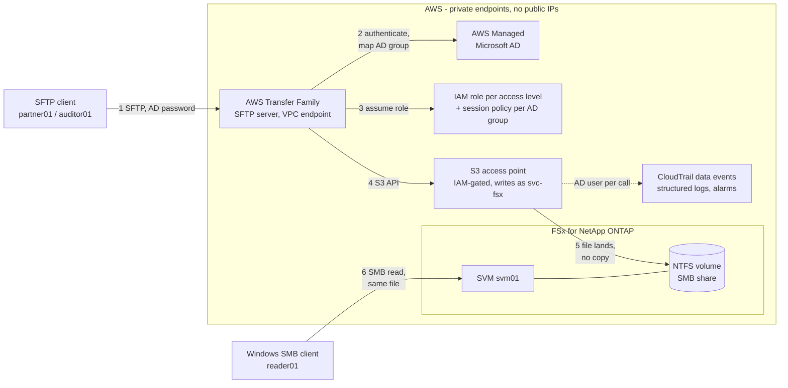
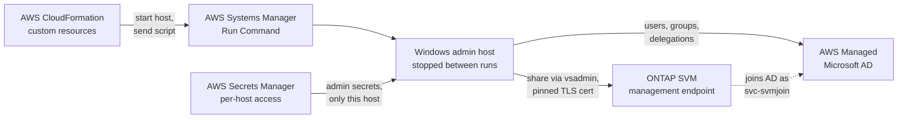

# Secure SFTP file sharing with AWS Transfer Family, Amazon FSx for NetApp ONTAP and S3 access points

This AWS CDK (TypeScript) sample deploys an end-to-end SFTP file-sharing flow with **no data copying**:

1. An external partner **uploads a file over SFTP** and authenticates with an **Active Directory** username and password.
2. AWS Transfer Family writes the file **directly onto an Amazon FSx for NetApp ONTAP volume** (NTFS security style) through an **S3 access point**. There is no intermediate bucket, sync job or copy.
3. An internal Windows client **reads the same file off the file system over SMB**. One file, one location.

The sample follows the AWS Storage Blog post [Secure SFTP file sharing with AWS Transfer Family, Amazon FSx for NetApp ONTAP, and S3 Access Points](https://aws.amazon.com/blogs/storage/secure-sftp-file-sharing-with-aws-transfer-family-amazon-fsx-for-netapp-ontap-and-s3-access-points/) and adds least-privilege identities, an audit trail and an automated self-test.

> [!WARNING]
> This is sample code for demonstration and learning. It is not intended for production use as is. Review it against your own security, availability and compliance requirements before you adapt it. Deploying it creates billable resources (see [Cost](#cost)).

## Architecture

The demo clients run on private EC2 instances in the same VPC; in a real deployment the partner reaches the SFTP endpoint over VPN or AWS Direct Connect (or an internet-facing endpoint you add), and the SMB client sits on the corporate network.

### Data path



### Setup path

The AD objects, share and NTFS permissions are created by CloudFormation custom resources that run PowerShell on the admin host through Systems Manager. The admin host is stopped except during a setup run.



### Stacks

| Stack | Contents |
|---|---|
| `sftp-ontap-demo-network` | VPC (2 AZs, public and private subnets, one NAT gateway for egress), VPC flow logs, security groups that name source security groups instead of CIDRs |
| `sftp-ontap-demo-directory` | AWS Managed Microsoft AD; generated passwords for the AD admin and every demo user in AWS Secrets Manager |
| `sftp-ontap-demo-client` | Three private hosts with no inbound ports, driven only through AWS Systems Manager: a Windows **admin host** (runs the setup, kept **stopped**), a Windows **SMB reader**, and an Amazon Linux **SFTP client**. Encrypted EBS, IMDSv2, and each host can read only the secrets it needs |
| `sftp-ontap-demo-identity` | AD users, the groups `SftpPartners` and `SftpAuditors`, and two delegated service accounts, created on the admin host |
| `sftp-ontap-demo-fsx` | FSx for ONTAP file system, storage virtual machine (SVM) joined to AD with a delegated account, NTFS volume |
| `sftp-ontap-demo-sftp` | SMB share and NTFS permissions, the S3 access point on the volume, the Transfer Family server with one access per AD group, structured logs, alarms and a CloudTrail trail for file activity |
| `sftp-ontap-demo-demo` | The self-test function `sftp-ontap-demo-selftest` |

### SFTP groups and permissions

| AD group | Member | Lands in | Can |
|---|---|---|---|
| `SftpPartners` | `partner01` | `partner01/` | list, download, upload, delete |
| `SftpAuditors` | `auditor01` | `partner01/` | list and download only |

Every file operation reaches the volume as the same Windows identity (`svc-fsx`), so the difference between the groups is enforced on the AWS side, in three independent places:

1. **An IAM role per access level** (read-write, read-only) decides which S3 actions are possible.
2. **A session policy per group** limits the session to `partner01/`, as defence in depth behind the logical home-directory mapping.
3. **The access-point policy** allows only the two Transfer roles and the home-directory provisioner, denies writes for the read-only role, and explicitly denies every other principal, including administrators of the account.

## How it works

### Two independent security layers

1. **Transfer Family** authenticates the SFTP user (here, with the AD username and password through the native Directory Service identity provider) and authorizes the session through the IAM role and session policy of the user's AD group.
2. **The S3 access point** performs every file operation as one fixed file-system identity (`ANYBANK\svc-fsx`), whatever the SFTP user. NTFS permissions on the volume apply from there.

You can therefore change the SFTP authentication method without changing file ownership on the volume.

### Access-point network origin is `Internet`

Transfer Family calls the access point from service infrastructure outside your VPC, so an access point with `VPC` network origin would deny it. The access point is created with Internet origin (the CDK code omits `VpcConfiguration`). This does not expose it publicly: traffic between Transfer Family and the access point stays on the AWS network, and the gate moves from the network to IAM, which is why the access-point policy denies every principal except the named roles.

### Home directories are created through the S3 API

Through the access point, a directory is a zero-byte object whose key ends in `/`. A directory created over SMB or NFS has no such object, so it disappears from the S3 view as soon as it is empty, and SFTP logins into it fail. The sample therefore creates `partner01/` with `PutObject` before the first login and sets permissions over SMB afterwards.

### Network

- The Transfer Family server uses `EndpointType = VPC`: private IP addresses only, no public SFTP endpoint, and its security group allows TCP 22 only from the SFTP client's security group.
- Transfer Family to the access point and the volume: AWS network only.
- All hosts are reached through Systems Manager only: no RDP or SSH listeners, no inbound rules, no public IP addresses.

### Limits of SFTP on an FSx access point

These come from the service ([Transfer Family documentation](https://docs.aws.amazon.com/transfer/latest/userguide/fsx-s3-access-points.html)):

- Uploads are limited to **5 GB per file**.
- **Rename and append are not supported.** SFTP clients must disable "upload to temporary file name" features (for example, in WinSCP: *Transfer → Endurance*), or uploads fail.

## Prerequisites

- An AWS account and credentials with permissions to deploy the stacks (an administrator role is the simplest for a sample).
- A Region that offers AWS Transfer Family with the `AWS_DIRECTORY_SERVICE` identity provider, AWS Managed Microsoft AD, and S3 access points for FSx for NetApp ONTAP. The sample was tested in `eu-central-2`.
- Node.js 20 or later and npm.
- The account [bootstrapped for CDK](https://docs.aws.amazon.com/cdk/v2/guide/bootstrapping.html) in that Region.

## Deploy

```bash
npm ci
npx cdk bootstrap        # once per account and Region
npx cdk deploy --all
```

The target account and Region come from your AWS credentials and configured Region. To pick them explicitly, add `-c account=<account-id> -c region=<region>`.

Managed AD and FSx for ONTAP take about 30–45 minutes; a full deployment takes around an hour. There are no console steps: the AD and ONTAP setup runs on the admin host through Systems Manager, and Transfer access for each AD group is created with `CreateAccess`.

The first synth looks up the latest Windows Server 2022 and Amazon Linux 2023 AMIs and caches them in `cdk.context.json`. Keep that file: later deploys then never replace the hosts when AWS publishes new images. To change images deliberately, set `config.amis` in `lib/config.ts`.

To change names, the domain, sizing or the VPC CIDR, edit `lib/config.ts`.

## Test

The self-test is a Lambda function. It runs at deploy time only when the test code changes, and you can invoke it any time:

```bash
aws lambda invoke --function-name sftp-ontap-demo-selftest --cli-read-timeout 900 out.json && cat out.json
```

It discovers the server, access point and SMB endpoint at run time and fails unless every check holds:

1. **Endpoint:** VPC-only with no public IP; the server's host key matches the fingerprint Transfer Family reports.
2. **Authentication:** a wrong password is rejected; `nogroup01`, a valid AD user in no SFTP group, is rejected.
3. **Read-write:** `partner01` uploads `_selftest/payment_batch_001.txt` with a random value in it.
4. **Read-only:** `auditor01` downloads the file; its upload and delete are refused.
5. **Confinement:** neither user can read a file outside the SFTP folder (`../`, `/../`, `/` and `../../` paths).
6. **SMB:** `reader01` reads the same bytes off the file system over SMB and cannot write.
7. **Integrity:** the SHA-256 is identical for the upload, the auditor's download and the SMB read.
8. **Access-point gate:** the test function's own role, which IAM allows to read the access point, is explicitly denied by the access-point policy.
9. **Cleanup:** the test file and folder are removed.

Evidence goes to the log group in the demo stack's `EvidenceLogGroup` output.

Unit tests and lint run without AWS access:

```bash
npm test
npm run lint
npx cdk synth      # also runs cdk-nag (AWS Solutions rules)
```

### Try it manually

Open a Session Manager shell on the SFTP client (`sftp-ontap-demo-sftp-client`), then run `sftp partner01@<endpoint-ip>` and enter the password from the secret `sftp-ontap-demo/ad-user-partner01`. On the SMB reader, map the share with `New-SmbMapping -RemotePath \\<smb-ip>\share -UserName ANYBANK\reader01`, which prompts for the password.

## Audit: who uploaded this file?

On the volume every file is owned by `svc-fsx`, so attribution comes from AWS:

- **Structured Transfer Family logs** (stack output `TransferLogGroup`, 365-day retention, kept when the stack is deleted). `CONNECTED` events name the AD user and IAM role; file events carry the `session-id` and the path. Join on `session-id` to attribute every operation to a user.
- **CloudTrail data events** for the access point, in a dedicated trail with log file validation. The caller is the Transfer role session `<role>/<ad-user>.<session-id>@<server-id>`, so every `PutObject`, `GetObject` and `DeleteObject` names the AD user, including refused calls. Events through an FSx-attached access point are typed `AWS::S3::Object`, which is what the trail's selector matches.
- **Alarms:** `sftp-ontap-demo-sftp-auth-failures` (5 or more failed logins in 5 minutes) and `sftp-ontap-demo-sftp-errors` (errors other than refused operations). Refused operations are counted in a separate `SftpAccessDenied` metric because the self-test causes them on purpose. The alarms have no notification target; add an Amazon SNS topic for real use.

## Security notes

- **Least-privilege identities.**
  - The directory `Admin` account is used only by the identity setup.
  - The SVM joins AD as `svc-svmjoin`, which has delegated join rights on the Computers OU only.
  - NTFS permissions are set by `svc-fsxadm`, a member of *AWS Delegated FSx Administrators*.
  - The SMB share is created through the SVM's own management endpoint as the SVM-scoped `vsadmin`. No host can read the cluster-wide `fsxadmin` password.
- **Admin host.** It stays stopped. Each setup run starts it, runs and stops it again, so the admin secrets are reachable only during a run.
- **ONTAP TLS certificate pinning.** The SVM management endpoint presents a self-signed certificate. Instead of skipping validation, the setup pins it: the certificate's SHA-256 is stored in the SSM parameter `/sftp-ontap-demo/ontap/svm-mgmt-cert-sha256` on the first run (trust on first use, while the file system is new), and every later connection must present exactly that certificate before credentials are sent. If ONTAP renews its certificate, the setup fails closed; verify the new certificate and delete the parameter to trust it.
- **No secrets in templates or logs.** Passwords are generated into Secrets Manager, reach CloudFormation only as dynamic references, and reach hosts only through the Secrets Manager API. They never appear on a command line. Values reach host scripts as base64-encoded JSON, never by text substitution.
- **Confused-deputy protection.** Both Transfer roles trust `transfer.amazonaws.com` only with `aws:SourceAccount` and an `aws:SourceArn` pinned to this server.
- **cdk-nag.** `npx cdk synth` runs the AWS Solutions rules. Accepted findings are acknowledged with a written reason in `lib/nag.ts`; any new finding fails the synth.
- **Automated Security Helper (ASH).** `scripts/ash-scan.sh` runs [ASH v3](https://github.com/awslabs/automated-security-helper) in local mode over the repository (bandit, checkov, detect-secrets, semgrep, npm audit) and over freshly synthesized CloudFormation templates (checkov, detect-secrets). Every suppression is listed with its reason in `.ash/.ash.yaml`. The one dependency finding is a dev-only `sprintf-js` advisory in the Jest toolchain with no patched release; its suppression expires so it gets re-checked.
- **Production hardening not included.** Secrets, log groups and the audit trail use AWS managed encryption keys; use customer managed AWS KMS keys if your policies require them. Add an SNS topic to the alarms, and consider a Multi-AZ FSx deployment type.

## Credentials

Passwords are generated once and never expire. Rotation is **not implemented**, because rotating `svc-svmjoin` also requires updating the SVM's stored AD credential (`UpdateStorageVirtualMachine`), and rotating a user requires re-running the identity setup. Do not turn on Secrets Manager rotation for these secrets as is.

## Lifecycle

The AD and share setups are custom resources with real create, update and delete:

- **Create and update** converge to the state declared in `lib/config.ts`. Users and groups you remove from the config are deleted from AD, group membership is reset to exactly what is declared, and editing a setup script re-runs it on the next deploy.
- **Stack deletion** removes the users, groups, OU delegation, SMB share and certificate pin. Cleanup is best effort: a failure is logged but never blocks the deletion. Data on the volume is never deleted by a setup script.

CloudFormation sees each setup as one resource, so drift detection cannot see manual changes inside AD or on the share; the next setup run corrects them.

## Availability

This sample uses a single-AZ FSx for ONTAP file system (`SINGLE_AZ_1`) and one NAT gateway to keep cost down. The Transfer Family endpoint spans two Availability Zones, but the storage is in one. For production, use a `MULTI_AZ` deployment type and a NAT gateway per AZ.

## Cost

The main ongoing costs are AWS Managed Microsoft AD (Standard, two domain controllers), the FSx for ONTAP file system (1 TiB SSD, 128 MBps), the Transfer Family server endpoint, the NAT gateway, and the two running EC2 instances (the admin host is stopped). Use the [AWS Pricing Calculator](https://calculator.aws/) for an estimate in your Region, and delete the stacks when you are done.

## Troubleshooting

| Symptom | Cause | Fix |
|---|---|---|
| SFTP login fails for a valid user | Home directory created over SMB/NFS and now empty | Create it with `PutObject` of a `dir/` key (see above) |
| Upload fails in a GUI client | The client uploads to a temporary name and renames | Disable temporary-file uploads in the client |
| `Invalid policy: Policy has invalid action` on the access point | `s3:GetBucketLocation` is not valid in an access-point policy | Keep it in the caller's IAM policy only |
| Access point replaced and SFTP mapped to a missing alias | The access-point policy is create-only; a changed reference re-renders it | Reference roles by fixed ARNs, as the sample does |
| Share setup fails with a certificate mismatch | ONTAP renewed the SVM management certificate | Verify it, then delete `/sftp-ontap-demo/ontap/svm-mgmt-cert-sha256` and redeploy |
| `sftp -b` never offers password authentication | `-b` forces `BatchMode=yes`, and ssh keeps the first value | Put `-o BatchMode=no` before `-b` |

## Cleanup

```bash
npx cdk destroy --all
```

Stacks are deleted in reverse dependency order, so the AD and share cleanup can still run on the admin host. This **permanently deletes the file system, all data on it, and the directory**.

Some resources are kept on purpose or reserved:

- **Kept:** the Transfer log group, the CloudTrail audit bucket, its server access-log bucket and the trail log group, as audit history.
- **Not deleted by the destroy:** the final backup FSx takes of the volume. It costs money until you delete it.
- **Reserved names:** Secrets Manager schedules the `sftp-ontap-demo/*` secrets for deletion, which reserves their names for up to 30 days and blocks a redeploy.

To remove the stacks with Python only, without Node.js, use `scripts/teardown.py` (`pip install boto3`). With `--purge-retained`, it also force-deletes the secrets so you can redeploy immediately. It defaults to a dry run:

```bash
python3 scripts/teardown.py --region <region>
python3 scripts/teardown.py --region <region> --yes --purge-retained
```

## Security

See [CONTRIBUTING](CONTRIBUTING.md#security-issue-notifications) for more information.

## License

This library is licensed under the MIT-0 License. See the [LICENSE](LICENSE) file.
